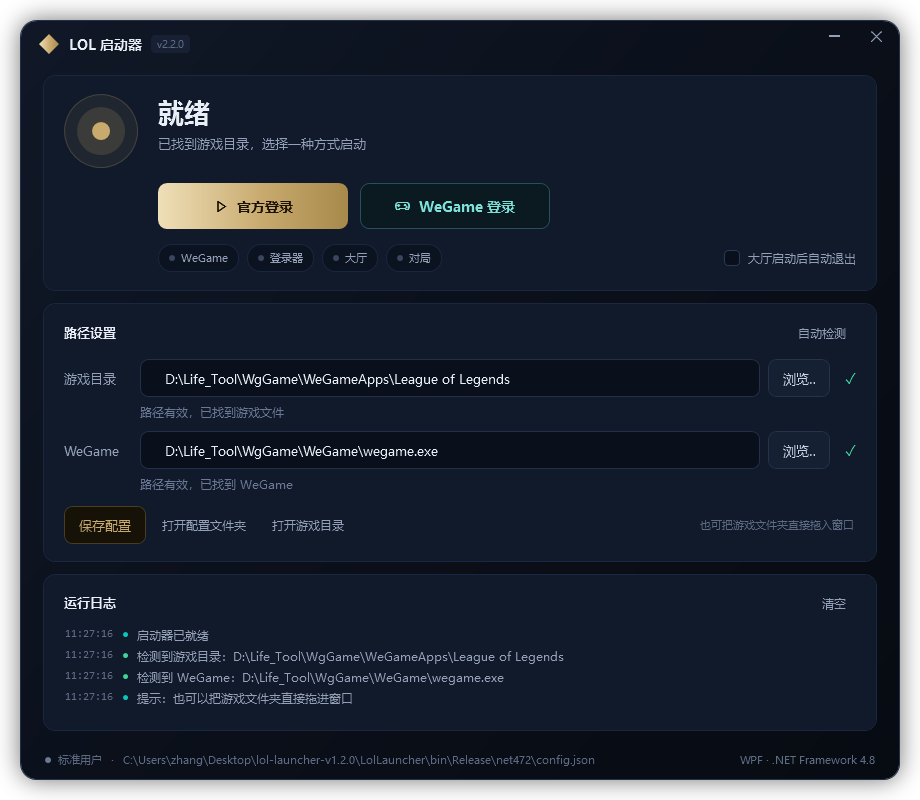
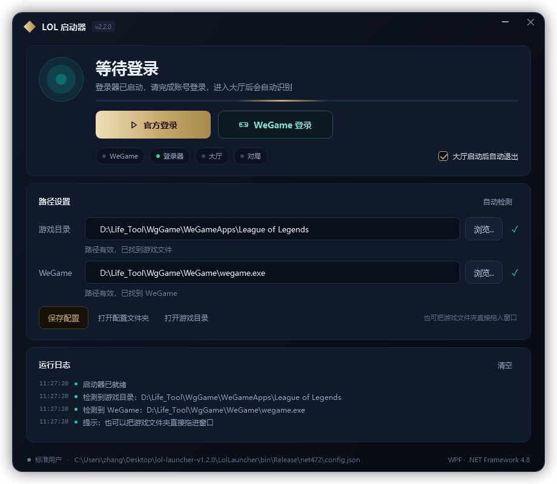
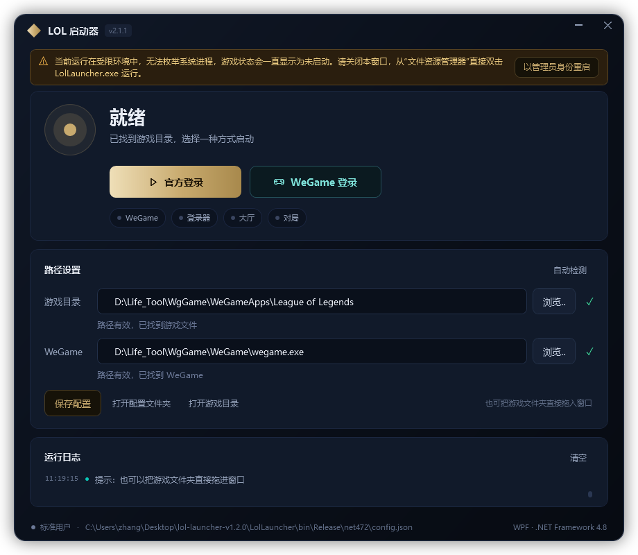

# LOL 启动器 v2.2.0

英雄联盟桌面启动器，**WPF + .NET Framework 4.8** 实现。支持官方登录与 WeGame 两种启动方式，带路径自动探测、实时状态面板和运行日志。



等待登录时的状态（金色流光 + 状态灯呼吸）：



---

## 功能

| 模块 | 说明 |
| :--- | :--- |
| 官方登录 | 启动 `<游戏目录>\Launcher\Client.exe`，直接弹出英雄联盟登录窗口 |
| WeGame 登录 | 启动已配置的 WeGame；未配置时使用 `<游戏目录>\WeGameLauncher\launcher.exe`；WeGame 已在运行时切换到前台 |
| 路径配置 | 自动检测 / 浏览选择 / 拖拽文件夹；校验 `Cross`、`Game`、`Launcher`、`LeagueClient` 四个子目录与 `Launcher\Client.exe` |
| 状态面板 | 未配置 → 就绪 → 正在启动 → 等待启动 → 等待登录 → 已进入大厅 → 对局中 → 已退出 / 启动失败 |
| 等待反馈 | 等待阶段状态灯呼吸、状态卡下方金色流光条持续流动，明确表示“正在等待” |
| 进程指示灯 | WeGame、登录器（`Launcher\Client.exe`）、大厅（`LeagueClient`）、对局（`League of Legends`）四个独立指示 |
| 运行日志 | 带时间戳与级别（信息 / 成功 / 警告 / 错误），自动滚动、可清空 |
| 自动退出 | 可选：进入大厅后倒计时 3 秒自动关闭启动器（不关闭游戏），设置写入 `config.json` |
| 配置 | `config.json` 与 exe 同目录，便携；兼容旧版启动器的 `LOL_ROOT_PATH` 字段 |
| 其他 | 单实例运行、拖拽配置、记住窗口路径、关闭时自动保存 |

---

## 运行

Windows 10 / 11，双击 `dist\LolLauncher.exe` 即可，**无需安装 .NET 运行时**（系统自带 4.8）。

首次启动若没有 `config.json`，会在窗口显示后自动探测一次安装位置；也可以点“自动检测”或手动选择。

> `config.json` 写在 exe 同目录，请不要把程序放在 `Program Files` 等只读目录。

---

## 构建

需要 .NET SDK（能编译 `net472` 即可）或 Visual Studio 2019：

```powershell
dotnet build LolLauncher/LolLauncher.csproj -c Release
```

产物：`LolLauncher/bin/Release/net472/LolLauncher.exe`（约 100 KB，无第三方 DLL）。

---

## 目录结构

```text
LolLauncher/
├── LolLauncher.csproj
├── App.xaml / App.xaml.cs          # 启动、单实例、--snapshot / --selftest 调试入口
├── MainWindow.xaml / .xaml.cs      # 无边框窗口、拖拽、日志自动滚动
├── Themes/Theme.xaml               # 深色主题、按钮/输入框/滚动条样式
├── ViewModels/MainViewModel.cs     # 状态机、命令、轮询
├── Models/                         # AppConfig / LogEntry / LaunchState
├── Services/
│   ├── GameLocator.cs              # 路径校验 + 自动探测
│   ├── ConfigStore.cs              # 便携 config.json 读写
│   └── LaunchService.cs            # 启动进程 / 激活已有窗口
├── Infrastructure/                 # ObservableObject / RelayCommand / 调色板
├── Native/NativeMethods.cs         # SetForegroundWindow 等
└── docs/                           # 界面截图
```

---

## 实现要点

- **MVVM 轻量实现**：`ObservableObject` + `RelayCommand`，不引入 MVVM 框架；状态由 `LaunchState` 枚举驱动。
- **1 秒轮询**：`DispatcherTimer` 刷新四个进程指示灯，并推进状态机（启动器退出、登录器出现、进入大厅、进入对局、游戏退出）。
- **进程识别**：`GameProcessWatcher` 一次枚举同时判断四类进程；`Client.exe` 会额外校验可执行文件位于游戏目录下，避免同名误判，`LeagueClient` / `League of Legends` 按独特进程名判断。
- **无外部依赖**：JSON 读写是内置的极简实现，UI 全部手写样式，`net472` 编译产物只有一个 exe。
- **自动退出**：进入大厅后由独立的 `DispatcherTimer` 做 3 秒倒计时，关闭窗口但保留已启动的游戏进程；取消勾选立即中止倒计时。
- **自动探测顺序**：运行中的进程 → 常见安装目录 → 限深/限时的广度优先扫描（8 秒、3 万目录上限），不会卡住界面。
- **安全边界**：只负责启动与状态观测，不注入、不修改游戏文件。

---

## 关于技术选型

本项目选择 **WPF + .NET Framework 4.8** 而不是 WinUI 3：

| | WPF + net48（本项目） | WinUI 3 |
| :--- | :--- | :--- |
| 用户端依赖 | 系统自带 4.8，单 exe 直接跑 | 需 Windows App SDK 运行时，或自包含 100MB+ |
| 开发/构建 | 现有 VS2019 / SDK 即可 | 需 VS2022 + .NET 8 SDK + Windows App SDK |
| 界面 | 全定制深色主题，可控性高 | 原生 Fluent，但本场景只有一屏 |
| 部署 | 拷贝即用 | 未打包模式有额外配置 |

WPF **不依赖任何浏览器内核**：它用 DirectX 自绘控件，不加载 Chromium / WebView2，也没有 HTML/CSS/JS 运行时。

---

## 已知限制

- WeGame 模式启动的是 WeGame 客户端本身，仍需在 WeGame 里点一次“启动游戏”；若游戏目录带 `WeGameLauncher\launcher.exe`，会自动使用它。
- 官方登录路径固定为 `Launcher\Client.exe`（国服客户端结构）。
- 仅支持 Windows。

---

## 排查：指示灯全灰 / 状态一直不更新

如果顶部出现黄色提示条，说明程序运行在**受限上下文**（例如从聊天窗口的附件卡片直接打开，或以低权限宿主启动）。
这种环境枚举不到系统进程，游戏状态会一直显示为未启动：



处理方式二选一：

1. 点提示条右侧的“以管理员身份重启”，通过 UAC 后以正常权限运行；
2. 关闭程序，从“文件资源管理器”直接双击 `LolLauncher.exe`（推荐日常这样启动）。

每次正常启动都会在 exe 同目录追加一行 `diagnostics.log`：

```text
[2026-11-21 11:20:00] v2.1.1.0 processes=126 explorer=True restricted=False wegame=1 login=0 lobby=1 game=0
```

`restricted=False` 且 `lobby=1` 表示识别正常；如果 `restricted=True`，说明运行环境受限，按上面两种方式之一启动即可。
